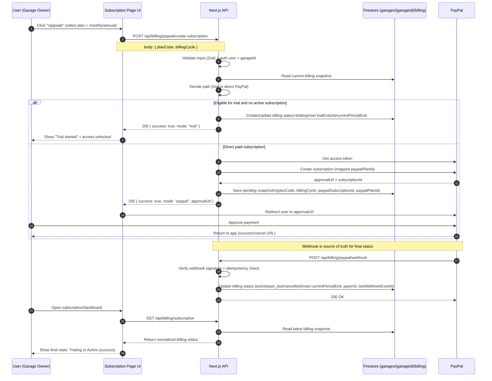

# Garixo Billing Flow (End-to-End)

This document describes the full subscription lifecycle for Garixo using PayPal, including trial handling and webhook confirmation.

## Goal

Ensure billing is reliable, secure, and user-friendly for garage owners:

- User can start a trial or paid subscription from the UI.
- PayPal handles payment authorization.
- Webhook is the source of truth for final subscription state.
- Firestore stores the canonical billing snapshot.

## Billing Data Model

Path:

- `garages/{garageId}/billing`

Core fields:

- `provider`: `'paypal'`
- `planCode`: `'starter' | 'growth'`
- `billingCycle`: `'monthly' | 'annual'`
- `status`: `'trialing' | 'active' | 'past_due' | 'cancelled' | 'suspended'`
- `trialEndsAt`
- `currentPeriodEnd`
- `cancelAtPeriodEnd`
- `paypalSubscriptionId`
- `paypalPlanId`
- `payerId`
- `paypalCustomerId` (optional payer/email reference)
- `founderEligible`
- `founderLockedUntil`
- `lastWebhookEventId`
- `webhookEventIdsRecent`
- `createdAt`
- `updatedAt`

## End-to-End Sequence



## Step-by-Step Runtime Flow

1. User opens `/dashboard/settings/subscription` and selects plan (`starter` or `growth`) and cycle (`monthly` or `annual`).
2. UI calls `POST /api/billing/paypal/create-subscription` with `planCode` + `billingCycle`.
3. API validates input with Zod, checks authenticated user and `garageId`.
4. API reads current billing doc from `garages/{garageId}/billing`.
5. Trial decision:

- If trial is allowed and user has no active subscription, write `status='trialing'`, `trialEndsAt`, and `currentPeriodEnd`.
- Return success immediately.

6. Paid decision:

- Resolve PayPal `plan_id` from internal mapping.
- Create PayPal subscription and return `approvalUrl`.
- Save `paypalSubscriptionId`, `paypalPlanId`, and pending billing snapshot in Firestore.

7. User approves payment in PayPal.
8. PayPal sends webhook to backend.
9. Backend verifies webhook signature and applies idempotency check (`lastWebhookEventId` / `webhookEventIdsRecent`).
10. Backend updates Firestore with final state (`active`, `past_due`, `cancelled`, etc.), period dates, and payer references.
11. UI fetches billing snapshot (`GET /api/billing/subscription`) and renders the true latest state.

## Required API Endpoints

- `POST /api/billing/paypal/create-subscription`
- `POST /api/billing/paypal/cancel-subscription`
- `POST /api/billing/paypal/webhook`
- `GET /api/billing/subscription`
- `POST /api/billing/trial/start` (if trial start is not handled in create-subscription)

## Webhook Lifecycle and Event Handling

Webhook endpoint:

- `POST /api/billing/paypal/webhook`

Important lifecycle behavior:

- Monthly plan: renewal happens about every 1 month.
- Annual plan: renewal happens about every 1 year.
- At each renewal cycle, payment can succeed, fail, or subscription can be cancelled/suspended.
- Webhook events must drive final billing state in Firestore.

Core events to handle:

- `BILLING.SUBSCRIPTION.ACTIVATED`
- `BILLING.SUBSCRIPTION.CANCELLED`
- `PAYMENT.SALE.COMPLETED`
- `BILLING.SUBSCRIPTION.PAYMENT.FAILED`

Event mapping for Garixo:

1. `BILLING.SUBSCRIPTION.ACTIVATED`

- When it happens:
  - First activation after user approves PayPal flow.
  - Possible re-activation after recovery.
- Project action:
  - Set billing `status='active'`.
  - Persist `paypalSubscriptionId`, `paypalPlanId`, `payerId` if present.
  - Recompute and set `currentPeriodEnd` from webhook/resource payload.
  - Keep founder lock fields unchanged.

2. `PAYMENT.SALE.COMPLETED`

- When it happens:
  - Charge success for recurring cycle (monthly/yearly) or first payment.
- Project action:
  - Keep or set `status='active'`.
  - Advance `currentPeriodEnd` based on billing cycle:
    - monthly: +1 month
    - annual: +1 year
  - Store latest successful payment timestamp (if you add a field later, e.g. `lastPaymentAt`).
  - Keep access fully enabled.

3. `BILLING.SUBSCRIPTION.PAYMENT.FAILED`

- When it happens:
  - Renewal charge failed.
- Project action:
  - Set `status='past_due'`.
  - Do not immediately delete subscription data.
  - Keep `paypalSubscriptionId` and plan info for recovery/retry.
  - UI should show calm message: payment issue, update payment method.
  - Optional grace policy:
    - keep limited access for X days, then suspend if unresolved.

4. `BILLING.SUBSCRIPTION.CANCELLED`

- When it happens:
  - User cancels or PayPal/system cancels subscription.
- Project action:
  - Set `status='cancelled'`.
  - If cancellation is period-end:
    - keep access until `currentPeriodEnd`.
    - set `cancelAtPeriodEnd=true`.
  - If immediate cancellation:
    - remove access right away.
  - Keep billing history fields for audit.

Optional but recommended additional event handling:

- `BILLING.SUBSCRIPTION.SUSPENDED`
  - set `status='suspended'`, restrict access.
- `BILLING.SUBSCRIPTION.RE-ACTIVATED`
  - set `status='active'`, restore access.

Webhook processing flow (server):

1. Receive webhook request.
2. Verify PayPal signature using `PAYPAL_WEBHOOK_ID`.
3. Parse `event_type` and `resource.id` (subscription ID).
4. Idempotency check:

- If `event.id` already processed, return `200` and skip.

5. Load billing doc by `paypalSubscriptionId` and garage context.
6. Apply event mapping update to `garages/{garageId}/billing`.
7. Save `lastWebhookEventId`, append to `webhookEventIdsRecent`, update `updatedAt`.
8. Return `200` quickly (do not block PayPal retries).

Failure and retry rules:

- If verification fails: return non-2xx, log security warning.
- If transient DB error: return non-2xx to allow PayPal retry.
- If event is valid but unknown: store event id and return `200` safely.

## Status Transition Rules

Allowed transitions:

- `trialing -> active`
- `trialing -> cancelled`
- `active -> past_due`
- `past_due -> active`
- `active -> cancelled`
- `active -> suspended`
- `suspended -> active` (if restored)

Rules:

- Do not move to `active` from client redirect alone.
- Only webhook-verified events can finalize payment state.
- Mark cancellation intent with `cancelAtPeriodEnd` when applicable.

## Security and Reliability

1. Webhook signature verification is mandatory.
2. Idempotency is mandatory:

- Ignore already-processed webhook event IDs.

3. Token/secret values must come from environment variables only.
4. Never expose PayPal secrets to client-side code.
5. Return generic, non-technical errors to end users.
6. Log detailed errors server-side only.
7. Keep audit-safe timestamps (`createdAt`, `updatedAt`) on every write.

## UX Requirements

1. Keep UI copy simple and reassuring for non-technical owners.
2. Show explicit states:

- Trial active
- Payment pending
- Active subscription
- Payment issue (`past_due`) with clear next action

3. Avoid technical messages like “400”, “forbidden”, “token invalid”.
4. On success, show clear CTA to continue to dashboard.

## Operational Checklist

Before production rollout:

1. Configure env vars:

- `PAYPAL_CLIENT_ID`
- `PAYPAL_CLIENT_SECRET`
- `PAYPAL_ENV`
- `PAYPAL_WEBHOOK_ID`
- plan ID envs for starter/growth monthly/annual

2. Register webhook URL in PayPal dashboard.
3. Test all flows in sandbox:

- Trial start
- New subscription
- Cancel at period end
- Payment failure (`past_due`)
- Duplicate webhook delivery (idempotency)

4. Verify Firestore document updates match expected transitions.
5. Add monitoring for webhook failures and retry handling.

## Example Success Response Contract

```json
{
  "success": true,
  "data": {
    "status": "active",
    "planCode": "starter",
    "billingCycle": "monthly"
  }
}
```

## Notes

- Client redirect after PayPal approval improves UX but does not prove billing activation.
- Always trust backend webhook-verified state for entitlement control.
