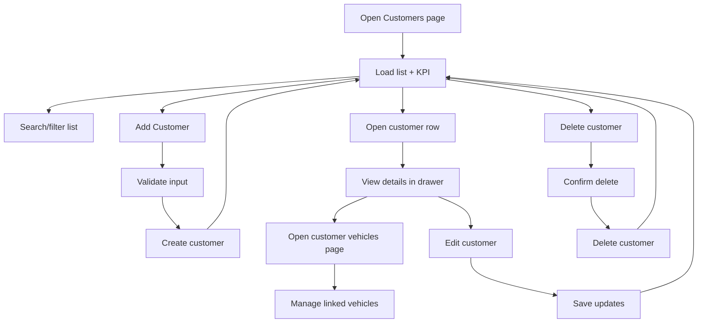

# Customer Management Feature Guide

This document introduces the Customer Management feature in Garixo for garage owners and service teams.

## 1) Description

Customer Management helps your shop:

- Keep customer profiles organized in one place
- Track visits and spending behavior over time
- Link customers to vehicles with a scalable relationship model
- Review recent service history before creating new work orders

The feature is designed for fast daily usage and clear decision-making.

## 2) Where to Find It in Dashboard

Path:

- `Dashboard` -> `Customers`
- URL: `/dashboard/customers`

Main sections on the page:

- Header:
  - Title: `Customers`
  - Action button: `Add Customer`
- KPI row:
  - Total customers
  - Active this month
  - Returning rate
  - Top spender
- Filters:
  - Search
  - Status
  - Spending tier
- Customers table:
  - Customer profile snapshot
  - Actions: view, edit, delete, copy phone
- Customer drawer:
  - View mode (profile + vehicles + service history + financial summary)
  - Create/edit mode (form)

## 3) Feature Flow

## 4) How It Works (System Behavior)

## 4.1 Read customer list

- API: `GET /api/customers`
- Supports:
  - `search`
  - `status`
  - `spendingTier`
  - `page`, `pageSize`
- Search includes:
  - customer name
  - customer phone
  - linked vehicle plate

## 4.2 Create customer

- API: `POST /api/customers`
- Key checks:
  - Auth + garage context must be valid
  - Payload schema validation
  - Phone must be unique in garage

## 4.3 Update and delete customer

- APIs:
  - `PUT /api/customers/{id}`
  - `DELETE /api/customers/{id}`
- Key checks:
  - Customer must exist in garage
  - Phone uniqueness is enforced for updates

## 4.4 Customer detail and related data

- API: `GET /api/customers/{id}`
- Drawer shows:
  - Basic profile
  - Linked vehicles
  - Recent service history
  - Financial summary (visits, spent, average ticket)

## 4.5 Customer-vehicle relationship model

Current design is relation-based:

- Vehicle stores `customerId`
- Customer shows `totalVehicles` summary
- Vehicle records are fetched by `customerId` condition

This avoids embedded `vehicles[]` arrays in customer data and scales better.

## 5) Customer Guide (How to Use in Dashboard)

Target users: owner garage and non-technical staff.

## 5.1 First-time setup

1. Open `Dashboard` -> `Customers`.
2. Add customer with:
   - Name
   - Phone
   - Optional email/address/notes
3. Save.
4. Open customer details and link vehicles.

## 5.2 Daily routine

1. Search customer by name, phone, or plate.
2. Open detail drawer before creating a new job.
3. Check:
   - Last visit
   - Service history
   - Total spent
4. Use this context for better recommendations and upsell timing.

## 5.3 Keep records healthy

- Update contact information when customer data changes.
- Add notes for important communication context.
- Keep vehicle links correct to avoid work-order mistakes.

## 6) KPI Meaning (Simple)

- `Total Customers`:
  Number of customers in your current list scope.
- `Active This Month`:
  Customers with a recent visit in the current month.
- `Returning Rate`:
  Percentage of customers with more than one visit.
- `Top Spender`:
  Highest total spend value among current list data.

## 7) Best Practices

- Use a consistent phone format to reduce duplicates.
- Add email whenever possible for invoice and communication flow.
- Review returning customers weekly for follow-up opportunities.
- Use notes for service preferences or recurring issues.

## 8) Common Messages and Meaning

- `Phone already exists.`:
  Another customer in your garage already uses that phone.
- `Could not load customer data.`:
  Temporary loading issue; refresh and retry.
- `Could not save customer.`:
  Validation or server-side processing issue.

## 9) Permissions and Access

- Customer data is garage-scoped.
- API authorization is enforced server-side.
- UI role behavior is guided in frontend, but backend rules are final.

## 10) Technical Reference

Main UI modules:

- `/src/features/customers/components/customers-management-page.tsx`
- `/src/features/customers/components/customer-drawer.tsx`
- `/src/features/customers/components/customers-table.tsx`
- `/src/features/customers/components/customers-filters.tsx`

Feature modules:

- `/src/features/customers/hooks.ts`
- `/src/features/customers/service.ts`
- `/src/features/customers/schema.ts`
- `/src/features/customers/types.ts`

Related APIs/services:

- `/src/app/api/customers/route.ts`
- `/src/app/api/customers/[id]/route.ts`
- `/src/services/firebase/customers-service.ts`

## 11) Summary

Customer Management gives your garage a clear customer profile center connected to vehicles, visits, and spending. It helps staff work faster, improves service quality, and supports better owner decisions with minimal complexity.
