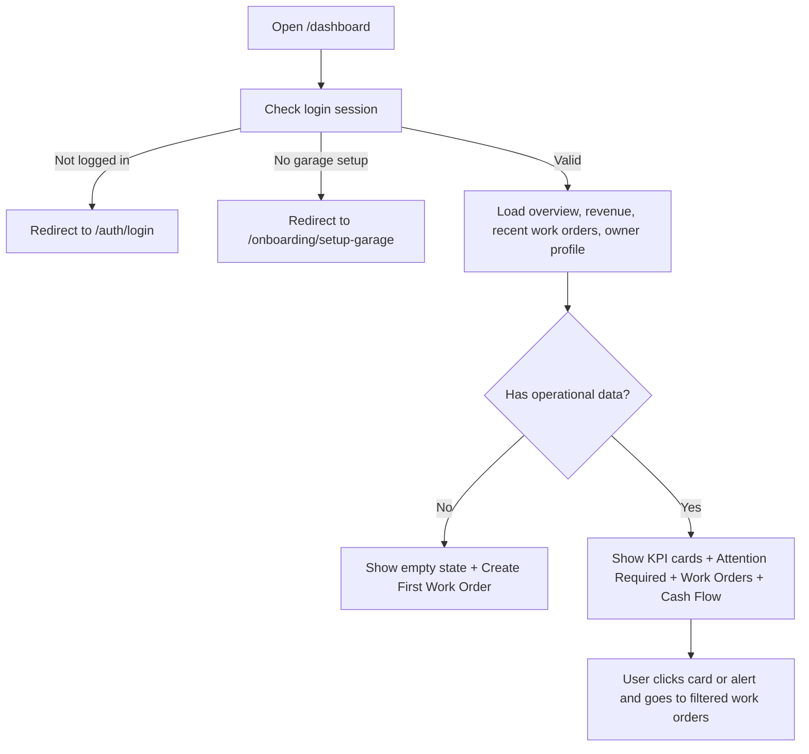

# Dashboard Home Feature Guide

This document introduces the Dashboard Home feature in Garixo for garage owners and non-technical staff.

## 1) Description

Dashboard Home is the daily control center at `/dashboard`.

It is designed to help owners quickly understand:

- What needs attention right now
- How many jobs are moving through the shop
- How much revenue is coming in today, this week, and this month
- What recent work orders need follow-up

Core goals:

- Fast scanning (no complex screens)
- Clear action-first workflow
- Friendly UI for non-technical users

## 2) Flow

## 3) How To Work

## 3.1 System behavior

When user enters `/dashboard`:

1. Validate authentication.
2. Resolve current garage context.
3. Load data in parallel:
   - Dashboard overview summary
   - Revenue summary (today/week/month)
   - Work orders list (mapped to recent top 5)
   - User profile (for email verification reminder)
4. Render one of two modes:
   - Empty mode: no operations data yet
   - Active mode: KPI cards + action blocks

## 3.2 Empty mode behavior

If there is no activity yet (no jobs, no revenue, no recent work orders):

- Show simple message: no jobs yet today
- Show one primary action: `Create First Work Order`
- Show onboarding tooltip with a direct CTA

This reduces decision friction for first-time users.

## 3.3 Active mode behavior

Dashboard shows:

- Snapshot cards:
  - Cars in Shop
  - Waiting for Approval
  - Ready for Pickup
  - Today Revenue
- Attention Required panel (if any value > 0)
- Recent Work Orders list (desktop table + mobile cards)
- Cash Flow Snapshot (today/week/month)

All key cards are clickable and route users directly to relevant filtered work-order views.

## 3.4 Email verification reminder

The verification reminder is shown only when:

- Owner has email
- Email is not verified
- Account age is at least 1 day

After clicking resend:

- System sends verification email
- Friendly success feedback is shown
- Notice auto-hides after a short delay

## 3.5 Auto-refresh

Dashboard runs a 60-second refresh cycle (`router.refresh()`) so owners can see updated operations without manual reload.

## 4) Guideline For Customer (How To Use In Dashboard)

Target user: garage owner and non-technical staff.

## 4.1 Morning routine (1-2 minutes)

1. Open Dashboard.
2. Check `Waiting for Approval` first.
3. Check `Ready for Pickup` to collect payment quickly.
4. Check `Cars in Shop` for workload balance.

## 4.2 During the day

1. Use KPI cards to jump directly to filtered queues.
2. Keep statuses updated in work orders.
3. Use recent work orders block to continue active jobs quickly.

## 4.3 End-of-day check

1. Confirm no critical jobs are stuck.
2. Review `Today Revenue` and `This Week Revenue`.
3. Follow up on jobs waiting for customer approval.

## 5) Friendly UX Notes

To keep the dashboard simple and clear for non-technical users:

- Use short labels and familiar language
- Prioritize operational actions over heavy analytics
- Keep one clear primary action in empty state
- Surface urgent items in a single “Attention Required” block

## 6) Permission & Access

- Dashboard requires authenticated user session.
- Dashboard requires garage context.
- Linked pages still enforce their own API-level authorization.

## 7) Technical References

Main route:

- `src/app/(dashboard)/dashboard/page.tsx`

Main UI component:

- `src/features/onboarding/components/dashboard-onboarding-state.tsx`

Related services:

- `src/services/firebase/dashboard-summary-service.ts`
- `src/services/firebase/work-orders-service.ts`
- `src/services/firebase/user-sync-service.ts`

Verification notice component:

- `src/features/onboarding/components/email-verification-notice.tsx`
