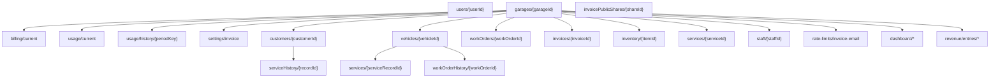
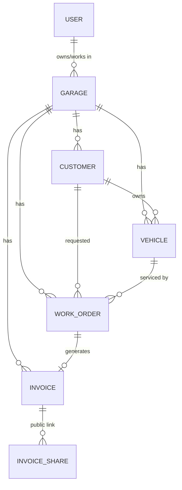
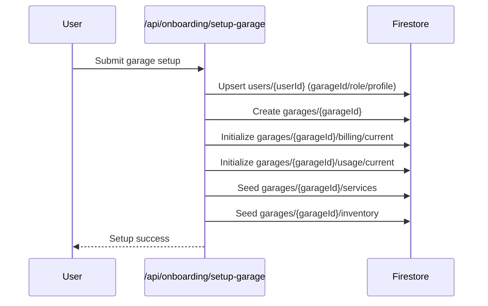
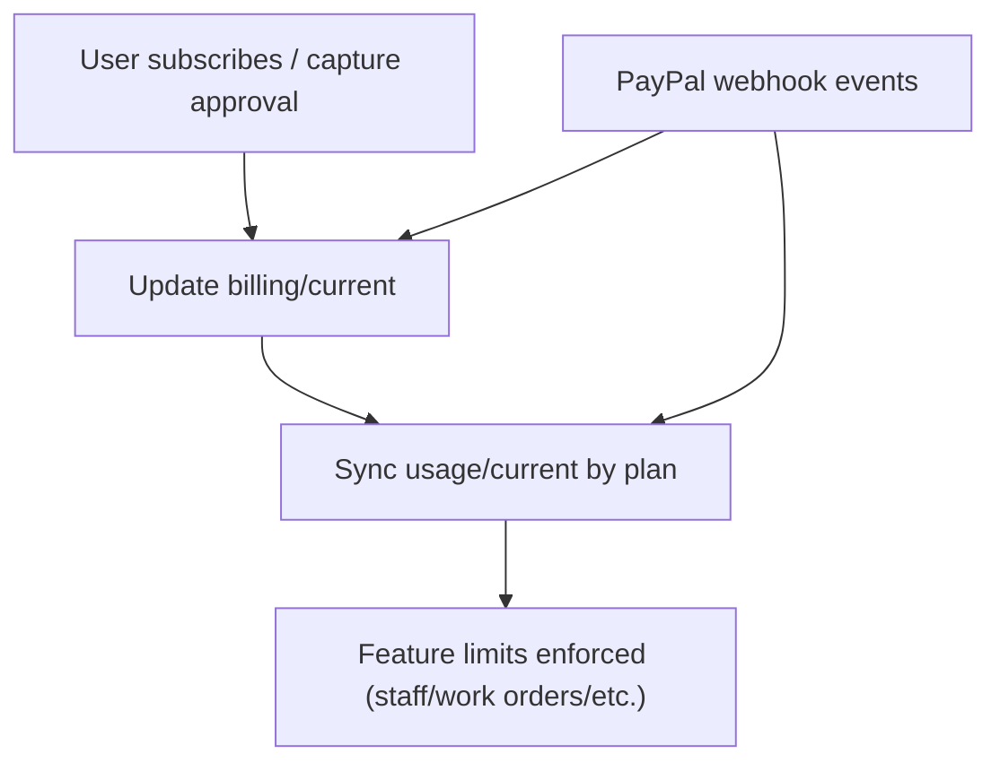
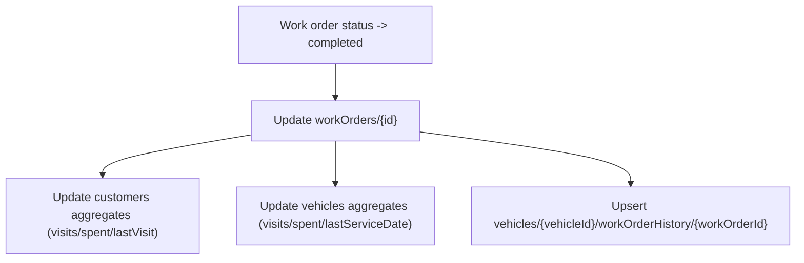
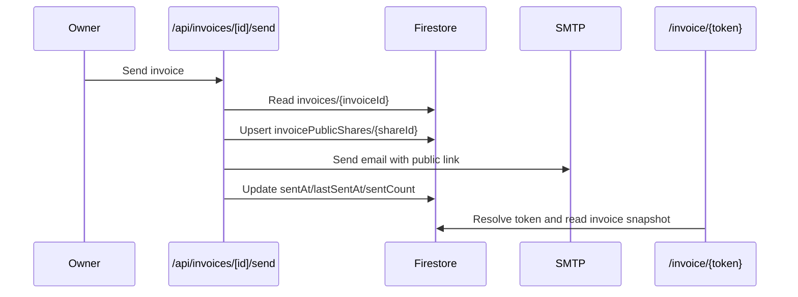

# Firestore Database Structure (Garixo)

This document describes the current Firestore data design used by Garixo, based on:

- `/Users/mrsteve.bang/Documents/New project/src/types/firebase-models.ts`
- Firestore usage in:
  - `/Users/mrsteve.bang/Documents/New project/src/services/firebase/*`
  - `/Users/mrsteve.bang/Documents/New project/src/app/api/*`

## 1) Purpose and Scope

This document is the practical reference for:

- Data structure by collection/subcollection
- Document fields and field purpose
- Relationships between entities
- Core data flows (onboarding, billing, work orders, invoices)
- Operational guidance for scaling safely

## 2) Design Principles

- Multi-tenant by garage:
  Most business data is scoped under `garages/{garageId}`.
- Consistent timestamp format:
  Date fields are stored as ISO-8601 strings.
- Fast reads for dashboard use cases:
  Some fields are denormalized for list/performance views.
- Feature isolation:
  Features are grouped by subcollections (work orders, invoices, staff, inventory, etc.).
- Additive evolution:
  Prefer adding fields over renaming/removing to minimize migration risk.

## 3) High-Level Firestore Map

## 4) Core Relationships

Relationship keys used in code:

- `users/{userId}.garageId -> garages/{garageId}`
- `garages/{garageId}.ownerUserId -> users/{userId}`
- `workOrders/{id}.customerId -> customers/{customerId}`
- `workOrders/{id}.vehicleId -> vehicles/{vehicleId}`
- `invoices/{id}.workOrderId -> workOrders/{workOrderId}`
- `invoicePublicShares/{id}.invoiceId -> invoices/{invoiceId}`

## 5) Document Reference and Field Purpose

## 5.1 `users/{userId}` (`UserDocument`)

Purpose: Authenticated account profile and garage association.

| Field                       | Type           | Purpose                                               |
| --------------------------- | -------------- | ----------------------------------------------------- |
| `id`                        | `string`       | Stable user identifier (matches auth UID).            |
| `email`                     | `string`       | Primary account email used for sign-in/communication. |
| `name`                      | `string`       | Display name in UI.                                   |
| `role`                      | `UserRole`     | Authorization role (`owner/admin/staff/user`).        |
| `garageId`                  | `string?`      | Tenant association for scoped data access.            |
| `avatarUrl`                 | `string?`      | Profile image URL.                                    |
| `emailVerifiedAt`           | `string/null?` | Verification timestamp for trust/security UX.         |
| `emailVerifyTokenHash`      | `string/null?` | Hashed one-time email verification token.             |
| `emailVerifyTokenExpiresAt` | `string/null?` | Expiration timestamp for verification token.          |
| `emailVerifyTokenUsedAt`    | `string/null?` | Marks token as single-use.                            |
| `createdAt`                 | `string`       | Account creation timestamp.                           |
| `updatedAt`                 | `string?`      | Last profile update timestamp.                        |

## 5.2 `garages/{garageId}` (`GarageDocument`)

Purpose: Top-level tenant document for one garage business.

| Field          | Type                  | Purpose                                                |
| -------------- | --------------------- | ------------------------------------------------------ |
| `id`           | `string`              | Garage ID (tenant key).                                |
| `ownerUserId`  | `string`              | Primary owner account reference.                       |
| `name`         | `string`              | Garage business name.                                  |
| `industryType` | `GarageIndustryType?` | Industry profile for default templates/setup behavior. |
| `address`      | `string?`             | Garage address for invoices and profile.               |
| `phone`        | `string?`             | Garage contact phone.                                  |
| `email`        | `string?`             | Garage contact email.                                  |
| `workingHours` | `string?`             | Human-readable schedule.                               |
| `logoUrl`      | `string?`             | Branding asset for UI/invoices.                        |
| `createdAt`    | `string`              | Tenant creation timestamp.                             |
| `updatedAt`    | `string`              | Tenant last update timestamp.                          |

## 5.3 `garages/{garageId}/billing/current` (`GarageBillingDocument`)

Purpose: Current subscription and billing lifecycle state.

| Field                   | Type              | Purpose                                                                 |
| ----------------------- | ----------------- | ----------------------------------------------------------------------- |
| `provider`              | `BillingProvider` | Billing gateway source (currently PayPal).                              |
| `planCode`              | `PlanCode`        | Internal plan (`free/starter/growth`).                                  |
| `billingCycle`          | `BillingCycle`    | Monthly or annual cycle.                                                |
| `status`                | `BillingStatus`   | Current billing state (`trialing/active/past_due/cancelled/suspended`). |
| `trialEndsAt`           | `string/null`     | Trial end boundary for plan entitlement.                                |
| `currentPeriodEnd`      | `string/null`     | Current paid period end timestamp.                                      |
| `lastPaidAt`            | `string/null`     | Last successful payment timestamp.                                      |
| `cancelAtPeriodEnd`     | `boolean`         | Scheduled cancellation flag.                                            |
| `paypalSubscriptionId`  | `string/null`     | External subscription reference.                                        |
| `paypalPlanId`          | `string/null`     | External plan reference.                                                |
| `paypalCustomerId`      | `string/null`     | External payer/customer reference.                                      |
| `payerId`               | `string/null`     | PayPal payer ID.                                                        |
| `founderEligible`       | `boolean`         | Early-adopter pricing eligibility.                                      |
| `founderLockedUntil`    | `string/null`     | Founder pricing lock period end.                                        |
| `lastWebhookEventId`    | `string/null`     | Last processed webhook event marker.                                    |
| `webhookEventIdsRecent` | `string[]`        | Recent event IDs for idempotency.                                       |
| `createdAt`             | `string`          | Billing record creation timestamp.                                      |
| `updatedAt`             | `string`          | Billing record update timestamp.                                        |

## 5.4 `garages/{garageId}/usage/current` (`GarageUsageCurrentDocument`)

Purpose: Active usage counters enforcing plan limits.

| Field           | Type                       | Purpose                                              |
| --------------- | -------------------------- | ---------------------------------------------------- |
| `periodKey`     | `string`                   | Logical billing/usage period key.                    |
| `periodStartAt` | `string`                   | Usage window start.                                  |
| `periodEndAt`   | `string`                   | Usage window end.                                    |
| `counters`      | `GarageUsageCounterItem[]` | Feature usage counters (e.g. `users`, `workOrders`). |
| `createdAt`     | `string`                   | Usage doc creation time.                             |
| `updatedAt`     | `string`                   | Last counters sync/update time.                      |

`GarageUsageCounterItem` field purpose:

| Field         | Type                     | Purpose                                           |
| ------------- | ------------------------ | ------------------------------------------------- |
| `key`         | `string`                 | Feature identifier (`users`, `workOrders`, etc.). |
| `value`       | `number`                 | Current consumed quantity.                        |
| `limit`       | `number`                 | Allowed quantity for current plan.                |
| `resetPolicy` | `monthly/yearly/forever` | Counter reset cadence.                            |
| `enabled`     | `boolean`                | Feature availability toggle by plan.              |
| `updatedAt`   | `string`                 | Last update time for this specific counter.       |

## 5.5 `garages/{garageId}/usage/history/{periodKey}` (`GarageUsageHistoryDocument`)

Purpose: Archived snapshot of usage counters for audit/reporting.

| Field           | Type                       | Purpose                     |
| --------------- | -------------------------- | --------------------------- |
| `periodKey`     | `string`                   | Historical period identity. |
| `periodStartAt` | `string`                   | Period start.               |
| `periodEndAt`   | `string`                   | Period end.                 |
| `counters`      | `GarageUsageCounterItem[]` | Frozen counters for period. |
| `snapshotAt`    | `string`                   | Snapshot capture time.      |
| `createdAt`     | `string`                   | Record creation.            |
| `updatedAt`     | `string`                   | Record update time.         |

## 5.6 `garages/{garageId}/settings/invoice` (`GarageInvoiceSettingsDocument`)

Purpose: Garage-level defaults for invoice calculation and payment terms.

| Field         | Type                                 | Purpose                                 |
| ------------- | ------------------------------------ | --------------------------------------- |
| `tax.enabled` | `boolean`                            | Toggle applying tax by default.         |
| `tax.rate`    | `number`                             | Default tax percentage rate.            |
| `tax.label`   | `string`                             | Tax label for UI/email/PDF readability. |
| `paymentTerm` | `DUE_ON_RECEIPT/NET_7/NET_15/NET_30` | Default due-date policy.                |
| `createdAt`   | `string`                             | Settings creation time.                 |
| `updatedAt`   | `string`                             | Last settings update time.              |

## 5.7 `garages/{garageId}/invoices/{invoiceId}` (`GarageInvoiceDocument`)

Purpose: Simple invoice record generated from work orders.

| Field             | Type                              | Purpose                                           |
| ----------------- | --------------------------------- | ------------------------------------------------- |
| `invoiceNumber`   | `string`                          | Human-readable invoice ID.                        |
| `workOrderId`     | `string`                          | Source work order reference.                      |
| `orderCode`       | `string`                          | Friendly work order code shown to owner/customer. |
| `customerId`      | `string/null`                     | Customer relation key.                            |
| `customerName`    | `string`                          | Snapshot display name at invoice time.            |
| `customerEmail`   | `string/null`                     | Recipient email snapshot.                         |
| `customerPhone`   | `string/null`                     | Recipient phone snapshot.                         |
| `vehicleId`       | `string/null`                     | Vehicle relation key.                             |
| `vehicleLabel`    | `string`                          | Vehicle summary shown on invoice.                 |
| `issuedAt`        | `string`                          | Invoice issue date.                               |
| `dueDate`         | `string`                          | Due date based on payment term.                   |
| `paymentTerm`     | `GarageInvoicePaymentTerm`        | Payment term snapshot.                            |
| `lineItems`       | `GarageInvoiceLineItemDocument[]` | Billable entries.                                 |
| `subtotal`        | `number`                          | Amount before tax.                                |
| `tax.enabled`     | `boolean`                         | Tax applicability snapshot.                       |
| `tax.rate`        | `number`                          | Tax rate snapshot.                                |
| `tax.label`       | `string`                          | Tax label snapshot.                               |
| `tax.amount`      | `number`                          | Calculated tax amount.                            |
| `total`           | `number`                          | Final amount due.                                 |
| `notes`           | `string/null`                     | Owner notes for customer.                         |
| `sentAt`          | `string/null`                     | First send timestamp.                             |
| `lastSentAt`      | `string/null`                     | Most recent send timestamp.                       |
| `sentCount`       | `number`                          | Number of send actions for rate/control UX.       |
| `createdAt`       | `string`                          | Invoice creation time.                            |
| `updatedAt`       | `string`                          | Last invoice update time.                         |
| `createdByUserId` | `string`                          | Actor who created invoice.                        |
| `updatedByUserId` | `string`                          | Actor who last modified invoice.                  |

## 5.8 `invoicePublicShares/{shareId}` (`InvoicePublicShareDocument`)

Purpose: Tokenized public sharing for invoice viewing.

| Field             | Type          | Purpose                                      |
| ----------------- | ------------- | -------------------------------------------- |
| `garageId`        | `string`      | Tenant ownership reference.                  |
| `invoiceId`       | `string`      | Linked invoice ID.                           |
| `tokenHash`       | `string`      | Hashed token for secure lookup/validation.   |
| `publicToken`     | `string`      | Public token used in URL route.              |
| `isActive`        | `boolean`     | Revocation/active control.                   |
| `expiresAt`       | `string/null` | Link expiration timestamp.                   |
| `createdByUserId` | `string`      | Actor who created link.                      |
| `lastViewedAt`    | `string/null` | Last access timestamp for activity tracking. |
| `createdAt`       | `string`      | Share creation time.                         |
| `updatedAt`       | `string`      | Share update/revoke time.                    |

## 6) Feature Collections (Garage-Scoped)

These collections are actively used by services/APIs:

- `customers/{customerId}` (+ `serviceHistory/{recordId}`)
- `vehicles/{vehicleId}` (+ `services/{serviceRecordId}`, `workOrderHistory/{workOrderId}`)
- `workOrders/{workOrderId}`
- `staff/{staffId}`
- `services/{serviceId}`
- `inventory/{itemId}`
- `invoices/{invoiceId}`
- `rate-limits/invoice-email`
- `dashboard/*`, `revenue/entries/*` (summary/reporting flows)

## 7) Data Flow Diagrams

## 7.1 Onboarding Bootstrap Flow

## 7.2 Billing Lifecycle Sync (PayPal + Usage)

## 7.3 Work Order Completion and History Updates

## 7.4 Invoice Send and Public Share Flow

## 8) Query and Index Guidance

Common query patterns from the current codebase:

- By tenant (`garageId`) and resource list pagination
- Work order list with status/date filters
- Vehicles by `customerId`
- Billing lookup by external IDs (PayPal subscription ID)
- Invoice/public share lookup by token

Index recommendations:

- Add composite indexes for frequent filtered lists (status + date + paging)
- Keep relation lookup fields indexed (`customerId`, `vehicleId`, `workOrderId`, `invoiceId`)
- Validate query plans whenever adding new filters

## 9) Security and Access Notes

- Tenant-scoped collections under `garages/{garageId}` should only be accessible by users in the same tenant.
- Public invoice endpoint must only expose safe invoice data and validate token state (`active`, `expiresAt`).
- Admin-wide endpoints (e.g. `/api/users` current behavior) should be intentional and documented.

## 10) Change Management Checklist

When updating Firestore structure:

1. Update model types in `/src/types/firebase-models.ts`
2. Update related service(s) in `/src/services/firebase/*`
3. Update related API route(s) in `/src/app/api/*`
4. Update this document
5. Add release note in `CHANGELOG.md`
