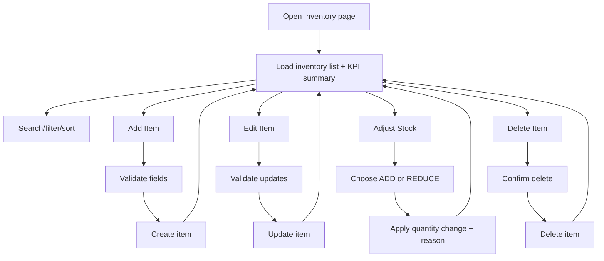

# Inventory Management Feature Guide

This document introduces the Inventory Management feature in Garixo for garage owners and service teams.

## 1) Description

Inventory Management helps your shop:

- Track parts and consumables in one place
- Monitor stock level and low-stock risk
- Reduce job delays caused by missing parts
- Keep purchase/restock decisions simple and data-driven

The feature is designed for fast, daily use by non-technical users.

## 2) Where to Find It in Dashboard

Path:

- `Dashboard` -> `Inventory`
- URL: `/dashboard/inventory`

Main sections on the page:

- Header:
  - Title: `Inventory`
  - Action button: `Add Item`
- KPI cards:
  - Total items
  - In stock / low stock / out of stock indicators
- Filters:
  - Search
  - Category
  - Stock status
  - Sort
- Inventory table:
  - Item name, category, quantity, unit cost, stock status
- Actions:
  - Add item
  - Edit item
  - Adjust stock
  - Delete item

## 3) Feature Flow

## 4) How It Works (System Behavior)

## 4.1 Read inventory list

- API: `GET /api/inventory`
- Garage-scoped data only
- Supports:
  - `search`
  - `category`
  - `stockStatus`
  - `sort`
  - `page`, `pageSize`

## 4.2 Create inventory item

- API: `POST /api/inventory`
- Key checks:
  - Auth + garage context must be valid
  - Required fields must pass schema validation
  - Numeric values (quantity/cost/threshold) must be valid

## 4.3 Update inventory item

- API: `PUT /api/inventory/{id}`
- Key checks:
  - Item must exist in current garage
  - Update payload must pass validation

## 4.4 Adjust stock quantity

- API: `POST /api/inventory/adjust`
- Action types:
  - `ADD` (restock)
  - `REDUCE` (usage/loss/damage)
- Best practice:
  - Include a short reason for adjustment history clarity

## 4.5 Delete inventory item

- API: `DELETE /api/inventory/{id}`
- Key checks:
  - Item must exist in current garage scope

## 5) Stock Status Logic (Operational)

Inventory status should be interpreted as:

- `IN_STOCK`: quantity is healthy
- `LOW_STOCK`: quantity near reorder threshold
- `OUT_OF_STOCK`: quantity is zero

Why it matters:

- `LOW_STOCK` helps owner reorder before jobs are delayed.
- `OUT_OF_STOCK` should be actioned immediately for common repair items.

## 6) Customer Guideline (How to Use in Daily Dashboard)

Target users: owner garage and non-technical staff.

## 6.1 First-time setup

1. Open `Dashboard` -> `Inventory`.
2. Add commonly used parts first (oil, filters, brake pads, tire valves, etc.).
3. Set realistic starting quantity and unit cost.
4. Define reorder threshold for fast-moving items.

## 6.2 Daily routine

1. Check KPI cards at start of day.
2. Filter `LOW_STOCK` and `OUT_OF_STOCK`.
3. Create restock list from filtered items.
4. Adjust stock after receiving parts.

## 6.3 During work order operations

1. When part is used, reduce stock promptly.
2. Use clear reason text for adjustments.
3. Recheck low-stock list before closing shift.

## 6.4 Weekly owner review

1. Sort by quantity and review outliers.
2. Identify slow-moving items and overstock.
3. Update thresholds for better reorder timing.

## 7) Best Practices

- Use one naming style for items (avoid duplicates with different names).
- Keep categories consistent.
- Update quantity in real time after usage/restock.
- Set threshold per item importance and usage frequency.
- Review zero-stock items daily.

## 8) Common Messages and Meaning

- `Could not load inventory.`:
  Temporary loading issue. Refresh and retry.
- Validation error:
  One or more required fields are missing/invalid.
- `Item not found.`:
  Item may have been deleted or is outside current garage scope.

## 9) Permissions and Access

- Inventory data is garage-scoped.
- API authorization is enforced server-side.
- UI visibility can vary by role, but backend checks are final.

## 10) Technical Reference

Related UI modules:

- `/src/features/inventory/components/inventory-management-page.tsx`
- `/src/features/inventory/components/inventory-table.tsx`
- `/src/features/inventory/components/inventory-drawer.tsx`
- `/src/features/inventory/components/adjust-stock-modal.tsx`

Related feature modules:

- `/src/features/inventory/api.ts`
- `/src/features/inventory/service.ts`
- `/src/features/inventory/hooks.ts`
- `/src/features/inventory/types.ts`

Related APIs:

- `/src/app/api/inventory/route.ts`
- `/src/app/api/inventory/[id]/route.ts`
- `/src/app/api/inventory/adjust/route.ts`

## 11) Summary

Inventory Management gives your shop a clear and practical parts control system. It helps avoid service delays, improves planning, and gives owners quick visibility into stock health with minimal complexity.
