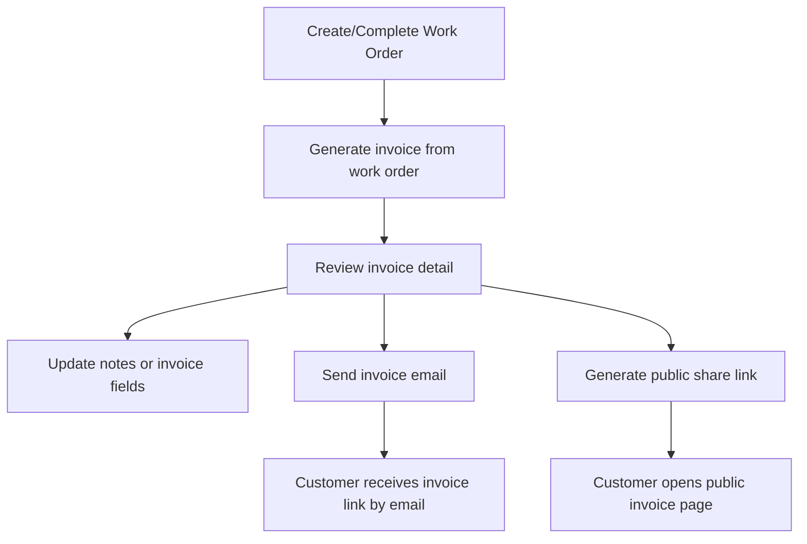

# Invoice Feature Guide

This document introduces the Invoice feature in Garixo for garage owners and service teams.

## 1) Description

The Invoice feature helps your shop:

- Create clear invoices from completed work orders
- Send professional invoice emails to customers
- Share secure public invoice links for easy customer access
- Keep invoice details consistent and easy to track

This is a practical, business-focused invoice system for day-to-day garage operations.

## 2) Where to Find It in Dashboard

Path:

- `Dashboard` -> `Invoices`
- URL: `/dashboard/invoices`

Main areas:

- Invoices list page
- Invoice detail page
- Send invoice section (email)
- Public share link section

## 3) Invoice Flow

## 4) How It Works (System Behavior)

## 4.1 Create invoice

- API flow supports creating invoice from work order:
  - `POST /api/invoices/from-work-order`
- Invoice data is saved in garage scope:
  - `garages/{garageId}/invoices/{invoiceId}`

## 4.2 Read and update invoice

- List invoices:
  - `GET /api/invoices`
- Read invoice detail:
  - `GET /api/invoices/{id}`
- Update invoice fields:
  - `PUT /api/invoices/{id}`

## 4.3 Send invoice email

- Send endpoint:
  - `POST /api/invoices/{id}/send`
- Behavior:
  - Creates/uses public share link
  - Sends email using invoice template
  - Updates send counters (`sentAt`, `lastSentAt`, `sentCount`)

## 4.4 Public invoice sharing

- Generate share:
  - `POST /api/invoices/{id}/share`
- Read current share:
  - `GET /api/invoices/{id}/share/current`
- Revoke share:
  - `POST /api/invoices/{id}/share/revoke`
- Public access endpoint:
  - `GET /api/public/invoices/{token}`

## 4.5 Rate limit protection

Invoice email sending is protected to prevent accidental spam:

- Limit: `20 emails/hour` per garage
- If exceeded:
  - UI shows friendly warning modal
  - User can retry later

## 5) Customer Guide (How to Use in Dashboard)

Target users: owner garage and non-technical staff.

## 5.1 Typical daily process

1. Open `Dashboard` -> `Invoices`.
2. Select the invoice you want to send.
3. Confirm customer email in the `Send Invoice` section.
4. Click send.
5. Confirm success message.

## 5.2 Before sending

Check:

- Customer name and contact
- Vehicle information
- Service line items and amounts
- Tax and total amount
- Due date/payment term

## 5.3 Sharing with customers

If customer cannot access email quickly:

1. Generate public link in invoice detail.
2. Copy link and send by message.
3. Revoke link if needed for safety.

## 6) Public Invoice Experience

Public invoice page is designed to be simple and safe:

- Clear amount and service summary
- Friendly unavailable/expired states
- Limited exposure of sensitive business/customer data

## 7) Best Practices

- Always review totals before sending.
- Keep customer email updated in profile.
- Use invoice notes for clear customer communication.
- Revoke and regenerate link if you suspect a wrong recipient.
- Track repeated send attempts to avoid confusion.

## 8) Common Messages and Meaning

- `Could not load invoice`:
  Temporary load issue; refresh and try again.
- `Rate limit reached`:
  Too many send attempts in a short period.
- `Public link unavailable`:
  Link was revoked/expired or not generated yet.

## 9) Permissions and Access

- Invoice data is garage-scoped.
- Auth is required for dashboard invoice actions.
- Public invoice route is token-based and controlled by active/expiry checks.

## 10) Technical Reference

Main UI:

- `/src/features/invoices/components/invoices-management-page.tsx`
- `/src/features/invoices/components/invoice-detail-page.tsx`
- `/src/features/invoices/components/public-invoice-page.tsx`

Main API routes:

- `/src/app/api/invoices/route.ts`
- `/src/app/api/invoices/from-work-order/route.ts`
- `/src/app/api/invoices/[id]/route.ts`
- `/src/app/api/invoices/[id]/send/route.ts`
- `/src/app/api/invoices/[id]/share/route.ts`
- `/src/app/api/invoices/[id]/share/current/route.ts`
- `/src/app/api/invoices/[id]/share/revoke/route.ts`
- `/src/app/api/public/invoices/[token]/route.ts`

Main services/templates:

- `/src/services/firebase/invoices-service.ts`
- `/src/lib/email/templates/invoice-template.ts`

## 11) Summary

The Invoice feature gives your garage a clean, reliable way to bill customers, send invoice emails, and share secure invoice links with minimal steps. It is built to be simple for everyday use while still protecting data and avoiding accidental send issues.
