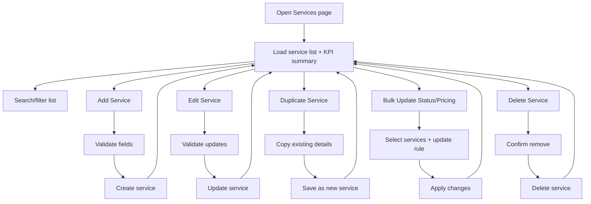

# Service Management Feature Guide

This document introduces the Service Management feature in Garixo for garage owners and service advisors.

## 1) Description

Service Management helps your shop:

- Build a clean service catalog (labor and standard jobs)
- Keep pricing and duration consistent across staff
- Speed up work-order creation with reusable service items
- Reduce quoting mistakes and improve customer trust

The feature is built for quick daily use and simple maintenance.

## 2) Where to Find It in Dashboard

Path:

- `Dashboard` -> `Services`
- URL: `/dashboard/services`

Main sections:

- Header:
  - Title: `Services`
  - Action button: `Add Service`
- KPI cards:
  - Total services
  - Active/inactive split
  - Pricing/usage summary indicators
- Filters:
  - Search
  - Category
  - Status
- Service table:
  - Name, category, default price, estimated duration, status
- Actions:
  - Add
  - Edit
  - Duplicate
  - Bulk update
  - Delete

## 3) Feature Flow

## 4) How It Works (System Behavior)

## 4.1 Read service list

- API: `GET /api/services`
- Data is garage-scoped
- Supports:
  - `search`
  - `category`
  - `status`
  - `page`, `pageSize`

## 4.2 Create service

- API: `POST /api/services`
- Key checks:
  - Auth + garage context
  - Required fields validation
  - Numeric fields (price/duration) sanity validation

## 4.3 Update service

- API: `PUT /api/services/{id}`
- Key checks:
  - Service must exist in current garage
  - Payload validation for name/price/duration/status

## 4.4 Bulk update

- API: `POST /api/services/bulk-update`
- Typical use:
  - Set many services to active/inactive
  - Apply controlled updates faster during pricing refresh

## 4.5 Delete service

- API: `DELETE /api/services/{id}`
- Key checks:
  - Service exists and belongs to current garage
  - Deletion constraints are enforced in backend/service logic

## 5) Why This Matters for Work Orders

Service records directly improve work-order speed and quality:

- Staff can pick standard service items quickly
- Price consistency improves quote confidence
- Standard durations help planning and workload balancing

## 6) Customer Guideline (How to Use in Daily Dashboard)

Target users: owner garage and non-technical staff.

## 6.1 First-time setup

1. Open `Dashboard` -> `Services`.
2. Add top 20 common services first.
3. Set:
   - clear name
   - category
   - default price
   - expected duration
4. Mark rare/seasonal services inactive if needed.

## 6.2 Daily routine

1. Use search to find service during work-order preparation.
2. Keep active services clean and up to date.
3. Duplicate similar services instead of creating from scratch.

## 6.3 Monthly pricing review

1. Filter by category.
2. Review service pricing with current costs.
3. Use bulk update where possible.
4. Retire outdated services by switching to inactive.

## 7) Best Practices

- Keep service names short and specific.
- Avoid duplicate services with different naming.
- Use default price as baseline, then adjust only when needed.
- Keep estimated duration realistic for scheduling.
- Prefer inactive over delete if you may need historical reference.

## 8) Common Messages and Meaning

- `Could not load services.`:
  Temporary loading issue. Refresh and retry.
- Validation error:
  Missing/invalid required field.
- `Service not found.`:
  Service may have been removed or outside current scope.

## 9) Permissions and Access

- Services are garage-scoped.
- Backend authorization is enforced on all service APIs.
- UI role visibility may vary, but server checks are final authority.

## 10) Technical Reference

Related UI modules:

- `/src/features/services/components/services-management-page.tsx`
- `/src/features/services/components/service-drawer.tsx`
- `/src/features/services/components/services-table.tsx`
- `/src/features/services/components/bulk-update-modal.tsx`

Related feature modules:

- `/src/features/services/api.ts`
- `/src/features/services/service.ts`
- `/src/features/services/hooks.ts`
- `/src/features/services/types.ts`

Related APIs:

- `/src/app/api/services/route.ts`
- `/src/app/api/services/[id]/route.ts`
- `/src/app/api/services/bulk-update/route.ts`

## 11) Summary

Service Management gives your garage a reliable catalog for pricing, estimation, and work-order speed. It reduces inconsistency, saves time at the front desk, and supports better daily decision-making without adding complexity.
