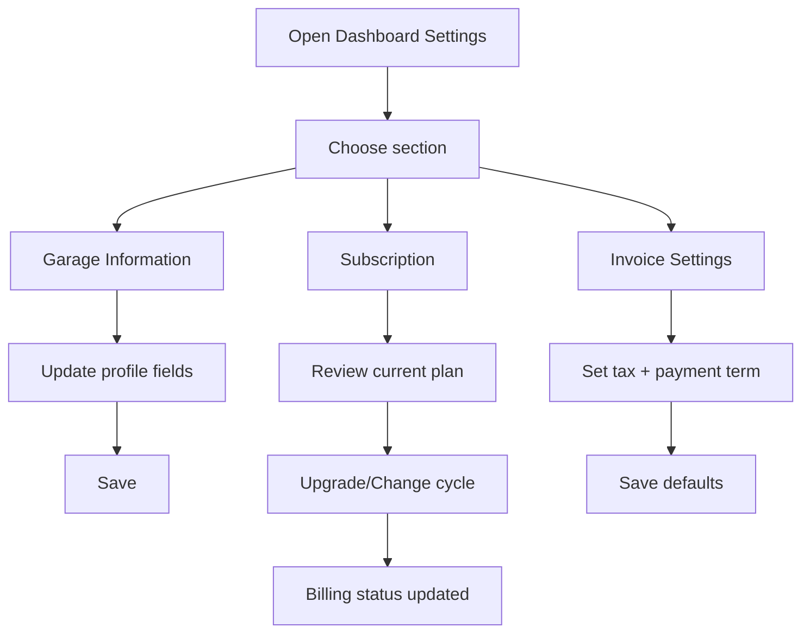

# Settings Feature Guide

This document introduces the Settings feature in Garixo for garage owners and administrators.

## 1) Description

The Settings module is where you configure important business-level information for your garage.

Current sections:

- Garage Information
- Subscription
- Invoice Settings

Why this matters:

- Keeps your shop profile accurate
- Controls plan and feature access
- Sets default invoice behavior for faster and more consistent billing

## 2) Where to Find It in Dashboard

Path:

- `Dashboard` -> `Settings`
- URL: `/dashboard/settings`

Main setting sections:

- `Garage Information`
- `Subscription`
- `Invoice`

## 3) Settings Flow

## 4) How It Works (System Behavior)

## 4.1 Garage Information

Purpose:

- Stores your garage profile and contact details used across the app.

Typical fields:

- Garage name
- Industry type
- Address
- Phone
- Email
- Working hours
- Logo (if configured)

Behavior:

- Data is saved under your garage scope.
- Updates affect how your business appears in key areas (profile, invoice context, etc.).

## 4.2 Subscription

Purpose:

- Shows current plan and billing status.
- Lets owner/admin move to a higher plan when needed.

Behavior:

- Reads billing snapshot from garage billing document.
- Handles subscription actions and callbacks (PayPal flow).
- Plan changes can affect feature limits (for example, user seats and usage limits).

Common statuses:

- Trial active
- Active
- Past due
- Cancelled
- Suspended

## 4.3 Invoice Settings

Purpose:

- Defines default invoice behavior for all new invoices.

Current setup includes:

- Tax:
  - enabled
  - rate
  - label
- Payment term:
  - `DUE_ON_RECEIPT`
  - `NET_7`
  - `NET_15`
  - `NET_30`

Behavior:

- Saved once and reused as defaults in invoice generation.
- Helps keep invoice output consistent for your team.

## 5) Customer Guide (How to Use in Dashboard)

Target users: owner garage and non-technical users.

## 5.1 First-time setup checklist

1. Open `Settings` -> `Garage Information`.
2. Fill core profile fields (name, phone, email, address).
3. Select the correct industry type.
4. Save.
5. Open `Settings` -> `Invoice`.
6. Configure tax and payment term.
7. Save.
8. Open `Settings` -> `Subscription` and review your current plan.

## 5.2 Monthly routine

1. Verify garage contact information is still correct.
2. Review subscription status and plan limits.
3. Check invoice tax/term defaults before accounting period changes.

## 5.3 When your team grows

1. Go to `Settings` -> `Subscription`.
2. Compare current user/usage limit with your operational needs.
3. Upgrade plan before you hit hard limits during busy periods.

## 6) Best Practices

- Keep profile email and phone current to avoid missed communication.
- Set invoice tax label clearly (example: `Sales Tax`).
- Choose payment terms your customers understand.
- Review subscription before peak seasons.
- Avoid frequent settings changes without team communication.

## 7) Common Messages and Meaning

- `Unauthorized`:
  Your session is expired or role does not allow this action.
- `Could not update settings`:
  Temporary issue; retry after refreshing.
- Plan-related warning:
  Current subscription may not include the requested capacity/feature.

## 8) Permissions and Access

- Settings are protected and scoped by garage.
- Sensitive actions (especially billing) are restricted to authorized roles.
- Backend authorization is always the final enforcement point.

## 9) Technical Reference

Main settings pages/components:

- `/src/features/settings/components/settings-module.tsx`
- `/src/features/settings/components/subscription-settings.tsx`
- `/src/features/settings/components/invoice-settings-form.tsx`

Related routes:

- `/src/app/(dashboard)/dashboard/settings/[section]/page.tsx`
- `/src/app/api/settings/garage/route.ts`
- `/src/app/api/settings/invoice/route.ts`
- `/src/app/api/billing/subscription/route.ts`

## 10) Summary

The Settings module is your control center for business profile, billing plan, and invoice defaults. Keeping these sections accurate helps your shop run smoothly, bill consistently, and scale with less friction.
