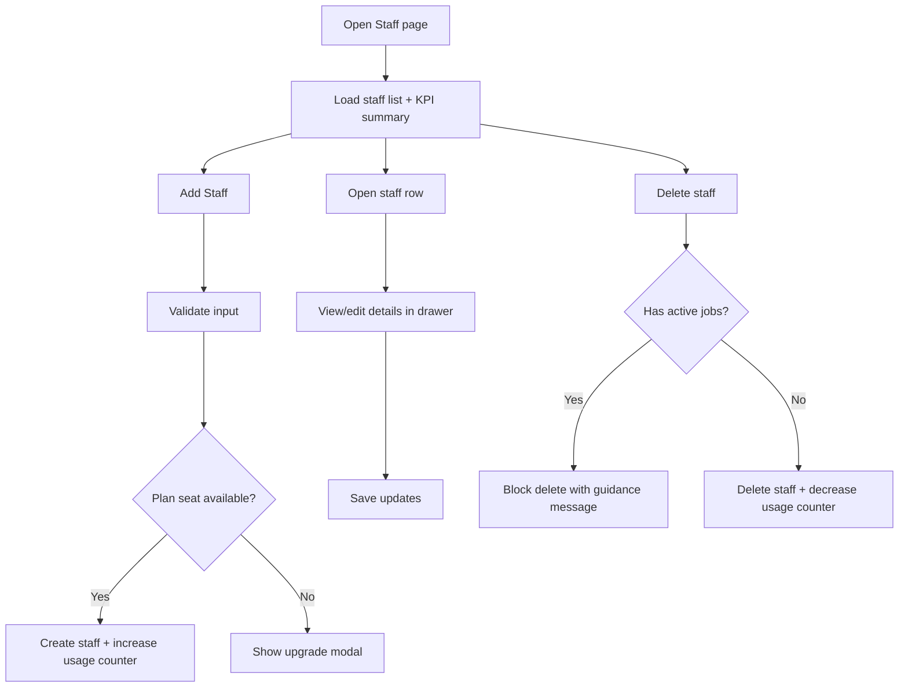

# Staff Management Feature Guide

This document introduces the Staff Management feature in Garixo for garage owners and team leads.

## 1) Description

Staff Management helps you:

- Add and maintain your team member profiles
- Track each staff member's workload
- Keep job assignment information organized
- Prevent over-capacity by enforcing your plan's user limit

This feature is designed to stay simple, readable, and fast for daily operations.

## 2) Where to Find It in Dashboard

Path:

- `Dashboard` -> `Staff`
- URL: `/dashboard/staff`

Main sections on the page:

- Header:
  - Title: `Staff Management`
  - Action button: `Add Staff`
- KPI cards:
  - Total staff
  - Active today
  - Free staff
  - Overloaded staff
- Staff table:
  - Name, role, status, current jobs, completed jobs, phone
- Dialogs and drawers:
  - Add staff modal
  - Edit staff drawer
  - Delete staff confirmation modal

## 3) Feature Flow

## 4) How It Works (System Behavior)

## 4.1 Read staff list

- API: `GET /api/staff`
- Returns all staff for current garage
- UI shows list and KPI summary

## 4.2 Add staff

- API: `POST /api/staff`
- Key checks:
  - User must be authenticated
  - Only owner can add staff
  - Phone must be unique in garage
  - Plan seat limit must allow new user
- If seat limit is reached:
  - API returns error
  - UI opens upgrade modal and guides user to subscription page

## 4.3 Update staff

- API: `PUT /api/staff`
- Key checks:
  - Staff exists
  - Phone remains unique
  - Cannot set `INACTIVE` if staff still has active jobs

## 4.4 Delete staff

- API: `DELETE /api/staff`
- Key checks:
  - Staff exists
  - Cannot delete if staff has active jobs
- On success:
  - Staff is removed
  - Usage counter for `users` is released

## 4.5 Usage and plan limits

- Usage counters are stored in:
  - `garages/{garageId}/usage/current`
- Staff seat counter key:
  - `counters['users']`
- Billing/plan data:
  - `garages/{garageId}/billing/current`
- Current baseline:
  - Owner is not counted as a staff seat baseline (`0`)

## 5) Customer Guideline (How to Use in Daily Operations)

Target user: owner garage and non-technical staff.

## 5.1 First-time setup

1. Open `Dashboard` -> `Staff`.
2. Click `Add Staff`.
3. Fill:
   - Full name
   - Phone
   - Role
   - Optional email
4. Click `Add Staff`.

## 5.2 Daily routine

1. Check KPI cards at the top:
   - If `Overloaded staff` is high, rebalance tasks.
2. Open team member row to review details.
3. Keep statuses updated (`ACTIVE`, `ON_LEAVE`, `INACTIVE`) for better planning.

## 5.3 Before deleting a staff member

1. Make sure all active jobs are completed or reassigned.
2. Delete only when `Current Jobs = 0`.
3. Confirm by typing the exact name in the delete modal.

## 5.4 If you cannot add more staff

If a message says your limit is reached:

1. Open `Upgrade Plan`.
2. Go to `Dashboard` -> `Settings` -> `Subscription`.
3. Choose a plan with more user seats.

## 6) Best Practices

- Keep phone numbers unique and consistent format.
- Add email for important notifications and account recovery.
- Review overloaded team members weekly.
- Do not inactivate users with active jobs.
- Remove inactive team members to keep usage clean.

## 7) Common Messages and Meaning

- `Phone must be unique.`:
  This phone is already used by another staff profile.
- `This staff has active jobs.`:
  Finish or reassign jobs before inactivating/deleting.
- `You reached your current user limit...`:
  Your current subscription does not have enough seats.

## 8) Roles and Permissions

- Owner:
  - Can add, update, and delete staff.
- Manager:
  - Can update staff details in UI flows where permitted.
- Staff:
  - Read/use operational data only, no user-management actions.

Note:

- API-level protection is always the final authority, even if a button is visible in UI.

## 9) Data and Audit Reference

Related backend modules:

- API route:
  - `/src/app/api/staff/route.ts`
- Service logic:
  - `/src/services/firebase/staff-service.ts`

Related UI modules:

- `/src/features/staff/components/staff-management-page.tsx`
- `/src/features/staff/components/add-staff-modal.tsx`
- `/src/features/staff/components/edit-staff-drawer.tsx`
- `/src/features/staff/components/delete-staff-modal.tsx`

## 10) Summary

Staff Management gives garage owners a simple control center for team setup and daily workload visibility, with built-in plan-limit protection to keep operations predictable and scalable.
