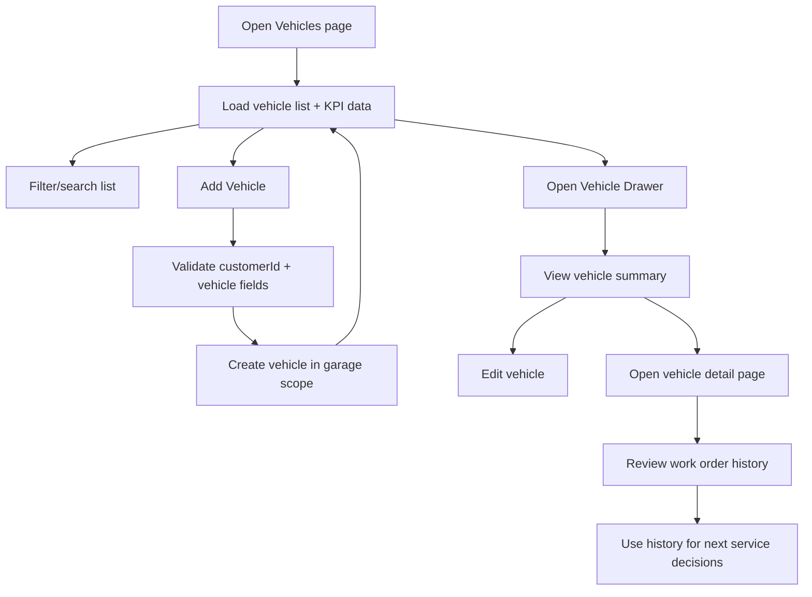

# Vehicles Management Feature Guide

This document introduces the Vehicles Management feature in Garixo for garage owners and service teams.

## 1) Description

Vehicles Management helps your shop:

- Keep a clean record for every customer vehicle
- Track service status and latest service activity
- Quickly open vehicle history before creating or updating work orders
- Reduce mistakes from missing vehicle details

This feature is built for fast daily usage on desktop and tablet.

## 2) Where to Find It in Dashboard

Path:

- `Dashboard` -> `Vehicles`
- URL: `/dashboard/vehicles`

Main sections on the page:

- Header:
  - Title: `Vehicles`
  - Action button: `Add Vehicle`
- KPI cards:
  - Total vehicles
  - Active / in service / overdue (based on current data)
- Filters:
  - Search
  - Brand
  - Status
  - Customer
- Vehicles table:
  - Plate, customer, brand/model, status, latest service indicators
- Vehicle drawer:
  - View details
  - Edit vehicle
  - Open vehicle detail page
- Vehicle detail page:
  - Full profile
  - Related work order history

## 3) Feature Flow

## 4) How It Works (System Behavior)

## 4.1 Read vehicle list

- API: `GET /api/vehicles`
- Data is garage-scoped.
- Supports pagination and filters:
  - `search`, `brand`, `status`, `customerId`, `page`, `pageSize`

## 4.2 Create vehicle

- API: `POST /api/vehicles`
- Key checks:
  - User must be authenticated in a valid garage context
  - `customerId` must be valid (relation-based model)
  - Required fields must pass schema validation

## 4.3 Update vehicle

- API: `PUT /api/vehicles/{id}`
- Key checks:
  - Vehicle must exist in current garage
  - Payload must pass schema validation

## 4.4 Delete vehicle

- API: `DELETE /api/vehicles/{id}`
- Key checks:
  - Vehicle must belong to current garage
  - Deletion follows service constraints in backend logic

## 4.5 Vehicle service and history views

- Vehicle services endpoint:
  - `GET /api/vehicles/{id}/services`
- Vehicle work order history endpoint:
  - `GET /api/vehicles/{id}/work-order-history`

Work order completion updates key vehicle metrics used in vehicle views:

- `totalVisits`
- `totalSpent`
- `lastServiceDate`

## 5) Data Model Notes (Important)

Vehicles are relation-based to customer (not embedded arrays in customer docs):

- Vehicle keeps `customerId`
- Customer list shows `totalVehicles` summary
- Customer vehicle details are fetched by relationship query

This design is better for scale and avoids stale duplicated arrays.

## 6) Customer Guideline (How to Use in Daily Dashboard)

Target users: owner garage and non-technical staff.

## 6.1 Add vehicle correctly

1. Go to `Dashboard` -> `Vehicles`.
2. Click `Add Vehicle`.
3. Select the correct customer first.
4. Enter plate, brand, model, year, and notes.
5. Save.

Tip:

- Always confirm plate number before saving to avoid duplicate records.

## 6.2 Find vehicles quickly

1. Use search by plate/customer.
2. Use status filter to find in-service or overdue vehicles.
3. Use customer filter when a customer has multiple vehicles.

## 6.3 Review before service

1. Open vehicle drawer.
2. Check latest service date and spend/visit summary.
3. Open vehicle detail page to view full work-order history.
4. Then create or update work order with full context.

## 6.4 Keep data clean

- Update vehicle details when ownership/contact changes.
- Avoid creating duplicate plate records.
- Link every vehicle to the correct customer.

## 7) Best Practices

- Standardize plate format for your team.
- Require customer verification before adding vehicle.
- Use notes for recurring issues (noise, oil leak, tire wear pattern).
- Review overdue vehicle list daily.
- Train staff to open history before quoting major repairs.

## 8) Common Messages and Meaning

- `Could not load vehicles.`:
  Temporary load issue. Refresh or check connection.
- `Vehicle not found.`:
  Vehicle may have been removed or belongs to another scope.
- Validation error:
  One or more required fields are missing/invalid.

## 9) Permissions and Access

- Vehicles data is scoped to current garage context.
- API authorization is enforced server-side.
- UI actions are also role-aware, but backend rules are final.

## 10) Technical Reference

Related UI modules:

- `/src/features/vehicles/components/vehicles-management-page.tsx`
- `/src/features/vehicles/components/vehicle-drawer.tsx`
- `/src/features/vehicles/components/vehicle-detail-page.tsx`

Related feature modules:

- `/src/features/vehicles/api.ts`
- `/src/features/vehicles/service.ts`
- `/src/features/vehicles/hooks.ts`
- `/src/features/vehicles/types.ts`

Related APIs:

- `/src/app/api/vehicles/route.ts`
- `/src/app/api/vehicles/[id]/route.ts`
- `/src/app/api/vehicles/[id]/services/route.ts`
- `/src/app/api/vehicles/[id]/work-order-history/route.ts`

## 11) Summary

Vehicles Management gives your shop a reliable, searchable vehicle record system tied directly to customers and work order history. It improves service accuracy, speeds up front-desk decisions, and helps owners see vehicle-level business value clearly.
