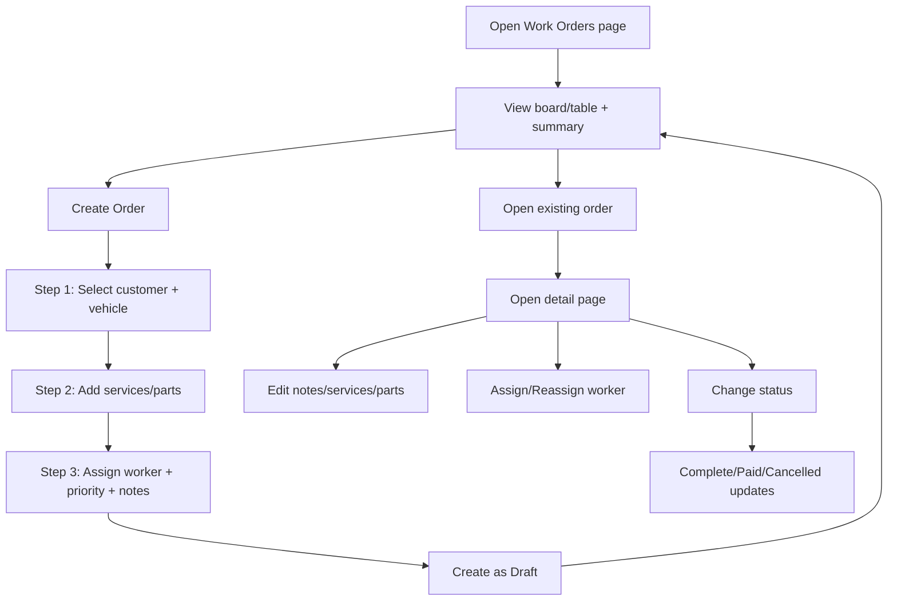
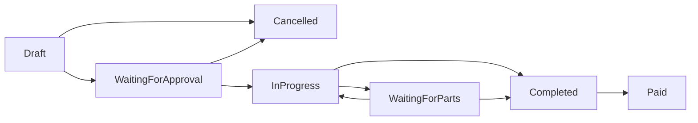

# Work Orders Management Feature Guide

This document introduces the Work Orders Management feature in Garixo for garage owners, service advisors, and workshop teams.

## 1) Description

Work Orders Management is the operational center of Garixo.

It helps your shop:

- Create and track repair jobs from start to finish
- Assign the right worker to each job
- Manage services, parts, notes, and status in one place
- Keep team workflow visible with board and table views
- Control plan usage limits for work-order creation

## 2) Where to Find It in Dashboard

Path:

- `Dashboard` -> `Work Orders`
- URL: `/dashboard/work-orders`

Main pages:

- Work orders management page (list + board)
- Work order detail page

Detail route:

- `/dashboard/work-orders/{id}`

## 3) Work Orders Flow

## 4) How It Works (System Behavior)

## 4.1 List and filter work orders

- API: `GET /api/work-orders`
- Supports:
  - `search`
  - `workerId`
  - `status`
  - `dateFilter` (`today` default, `all`, `this_week`, `this_month`, `custom`)
  - pagination

Note:

- UI default date filter is `today` when query param is missing.

## 4.2 Create a work order

- API: `POST /api/work-orders`
- Initial status:
  - `Draft`
- Validates:
  - required customer and vehicle context
  - payload schema
  - worker existence (if assigned)
- Calculates:
  - `totalAmount` from services + parts

Usage limits:

- Creation consumes `usage/current.counters['workOrders']`
- If feature disabled or limit reached:
  - API returns friendly plan-upgrade message
  - UI shows upgrade guidance modal

## 4.3 Update work order content

- API: `PUT /api/work-orders/{id}`
- Supports updates for:
  - notes
  - worker assignment
  - services/parts
  - plate/customer/vehicle references
  - priority and estimated time
- Recalculates total amount automatically

## 4.4 Status update

- API:
  - `PATCH /api/work-orders/{id}`
  - `PATCH /api/work-orders/{id}/status`
- Transition validity is enforced by backend + frontend transition rules.

## 5) Status Flow Guide

Status values:

- `Draft`
- `WaitingForApproval`
- `InProgress`
- `WaitingForParts`
- `Completed`
- `Paid`
- `Cancelled`

Allowed transitions:

- `Draft` -> `WaitingForApproval`, `Cancelled`
- `WaitingForApproval` -> `InProgress`, `Cancelled`
- `InProgress` -> `WaitingForParts`, `Completed`
- `WaitingForParts` -> `InProgress`, `Completed`
- `Completed` -> `Paid`
- `Paid` -> (final)
- `Cancelled` -> (final)

Business effects of final statuses:

- `Completed`:
  - deducts inventory (when applicable)
  - updates customer/vehicle service summary
  - updates staff counters/jobs logic
- `Paid`:
  - marks financial closure stage
- `Cancelled`:
  - closes order without payment completion

## 6) Guide: Start Add New Work Order

On `/dashboard/work-orders`, click `Create Order`.

Step-by-step:

1. Select existing customer (or create quick customer).
2. Select existing vehicle (or quick add vehicle if needed).
3. Add service items:
   - choose from active services
   - optionally quick-add a service
4. Add parts if required.
5. Assign worker.
6. Set priority and estimated time.
7. Add notes.
8. Submit to create work order.

If creation is blocked by plan:

- You will see an upgrade message/modal
- Continue in `Settings -> Subscription`

## 7) Guide: Assign Worker

You can assign worker in:

- Create flow before submit
- Work order detail page after creation

Best practice:

1. Choose worker with lower active jobs.
2. Confirm skill match for service type.
3. Reassign early if workload changes.

System behavior:

- Worker existence is validated by API.
- Staff current-jobs counters are adjusted when orders move to final statuses.

## 8) Work Order Detail Page Guide

Detail page route:

- `/dashboard/work-orders/{id}`

What you can do there:

- Review full order profile (customer, vehicle, timeline, amounts)
- Update notes
- Assign/reassign worker
- Add/remove services
- Add/remove/update parts
- Change status using allowed transitions
- Open related invoice actions

UX behavior:

- First load uses skeleton
- Mutations use section-level loading to avoid full page flicker
- Failed actions show clear error and rollback local optimistic updates

## 9) Customer Guide (How to Use in Daily Dashboard)

Target users: owner garage and non-technical staff.

## 9.1 Daily operating routine

1. Open `Work Orders`.
2. Keep view in `Board` for quick stage overview.
3. Switch to `Table` for dense list management.
4. Filter by worker or status.
5. Move jobs stage-by-stage during the day.

## 9.2 Start of day checklist

1. Check active and overdue counts.
2. Assign workers to unassigned jobs.
3. Review `WaitingForParts` queue.

## 9.3 End of day checklist

1. Confirm completed jobs.
2. Move completed jobs to paid when payment is received.
3. Review cancelled jobs and capture reasons.

## 10) Best Practices

- Create work orders with complete customer + vehicle data.
- Keep services and parts updated in detail page, not in notes only.
- Do not skip status progression; it improves reporting quality.
- Assign workers early to reduce queue ambiguity.
- Use priority only when truly needed to avoid alert fatigue.

## 11) Common Messages and Meaning

- `Assigned staff member was not found.`:
  Worker reference is invalid or outdated.
- `Invalid status transition.`:
  New status is not allowed from current stage.
- `You have reached your work order limit...`:
  Plan usage limit reached for current period.
- `Your current plan does not include work order creation...`:
  Feature is disabled for current plan tier.

## 12) Permissions and Access

- Work-order actions are authenticated and garage-scoped.
- API authorization is enforced server-side.
- UI role visibility can differ, but backend validation is final.

## 13) Technical Reference

Main UI modules:

- `/src/features/work-orders/components/work-orders-management-page.tsx`
- `/src/features/work-orders/components/create-order-form.tsx`
- `/src/features/work-orders/components/work-order-detail-page.tsx`
- `/src/features/work-orders/components/first-work-order-drawer.tsx`

Main APIs:

- `/src/app/api/work-orders/route.ts`
- `/src/app/api/work-orders/[id]/route.ts`
- `/src/app/api/work-orders/[id]/status/route.ts`
- `/src/app/api/work-orders/[id]/payment/route.ts`
- `/src/app/api/work-orders/[id]/cancel/route.ts`

Core backend logic:

- `/src/app/api/work-orders/work-orders-db.ts`
- `/src/services/firebase/dashboard-summary-service.ts`
- `/src/services/firebase/staff-service.ts`

## 14) Summary

Work Orders Management is the day-to-day execution engine of Garixo. It connects customer intake, technician assignment, service/parts control, status progression, and invoicing in one practical workflow designed for real garage operations.
